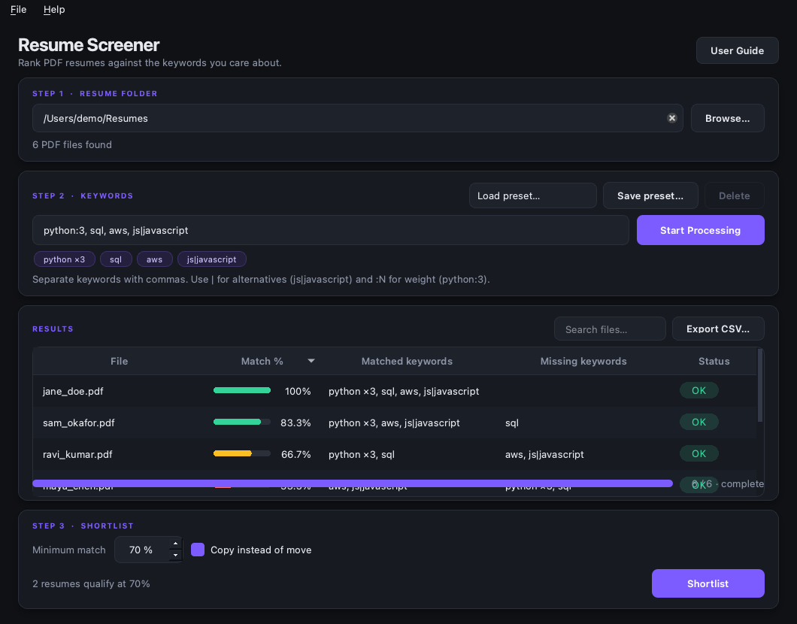
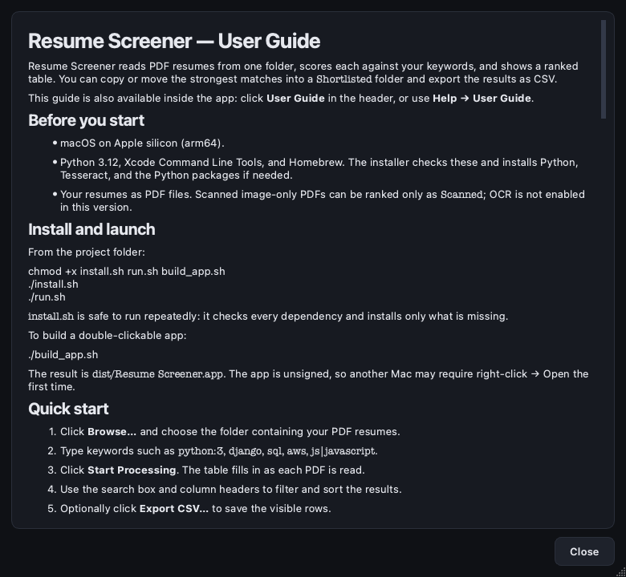

# Resume Screener


-green)

A native-feeling macOS app that reads a folder of PDF resumes, scores each one
against your keywords, and copies or moves the strongest matches into a
`Shortlisted` folder.

Built with **Python 3.12 + PySide6**, with PyMuPDF for text extraction. Everything
runs locally — resumes are never uploaded.



## Features

- Folder picker, drag-and-drop, and a live PDF count
- Comma-separated keywords, with `js|javascript` alternatives
- Weighted keywords (`python:3`) and saved keyword presets
- Background scanning with progress and cancel — the window never freezes
- Ranked, sortable results with a match bar, matched/missing keywords, and status
- Live count of resumes above the threshold
- CSV export of the visible results in their current ranked order
- Shortlist by copying (default) or moving, with collision-safe filenames
- Handles scanned, encrypted, and corrupt PDFs without aborting the scan
- Dark theme, saved settings, and keyboard shortcuts
- Built-in user guide via **Help → User Guide** or the header button

## Download a release

Release builds are published on the repository's **Releases** page as
`Resume-Screener-vX.Y.Z-macOS-arm64.zip`. Download the zip, unzip it, and move
`Resume Screener.app` wherever you like. Each release attaches
`SHA256SUMS.txt`, `LICENSE`, `THIRD_PARTY_NOTICES.md`, and the full
`AGPL-3.0.txt`/`LGPL-3.0.txt` texts.

The app is **unsigned and not notarized**. On another Mac, right-click the app
and choose **Open** the first time. To distribute more widely, sign and notarize
the build with an Apple Developer ID.

## Requirements (from source)

- macOS on Apple silicon
- Python 3.12
- Xcode Command Line Tools
- Homebrew

`install.sh` checks these and installs only what is missing.

## Quick start

From the project folder:

```bash
chmod +x install.sh run.sh build_app.sh
./install.sh     # checks everything and installs only missing dependencies
./run.sh         # launches the app
```

If you prefer to set up manually:

```bash
python3.12 -m venv .venv
source .venv/bin/activate
pip install -r requirements.txt
python app.py
```

## Usage

1. Choose the folder that holds your PDF resumes.
2. Enter keywords, for example `python:3, django, sql, aws, js|javascript`.
   Append `:N` to make a keyword count more heavily.
3. Press **Start Processing**. Results appear as each PDF is read.
4. Use the search box and column headers to filter and sort the results.
5. Optionally press **Export CSV…** (or `Cmd+E`) to save the visible rows.
6. Set the minimum match percentage and press **Shortlist**.
7. Resumes land in `<selected folder>/Shortlisted`. Copy is the default; untick
   **Copy instead of move** to move the originals instead.

Matching is case-insensitive and whole-word: `java` does not match
`javascript`, `C` does not match `C++`, and `js|javascript` counts as one
keyword where either spelling is accepted. Match % is the share of total
keyword weight that was found, so `python:3, sql` scores 75% when Python is
present but SQL is missing. Weights are positive integers and default to 1.

Use **Save preset…** next to the keyword field to name and store the current
keywords (weights included). Pick a preset from the dropdown to load it, or
select one and press **Delete**. Presets are stored with the rest of the app
settings and survive restarts.

Double-click a row to open the PDF in your default viewer.

The CSV export contains rank, file, numeric match %, matched/missing keywords,
status, and full path. Keyword lists are semicolon-separated, and the file is
UTF-8 with a BOM so Excel opens accented filenames correctly. Exporting respects
the current search filter and sort order.

## User guide

The full guide covers installation, scoring, presets, statuses, shortlisting,
CSV export, shortcuts, troubleshooting, and privacy:

- Read [USER_GUIDE.md](USER_GUIDE.md).
- Or open **Help → User Guide** inside the app (also the **User Guide** button).



## Tests

```bash
source .venv/bin/activate
pytest
```

The suite covers keyword parsing/weighting/scoring edge cases, preset
persistence, CSV export, shortlist folder and collision behavior, PDF extraction
statuses (OK, scanned, encrypted, corrupt), user-guide content sync and
rendering, and a headless end-to-end scan through the real window and worker
thread.

The GitHub Actions CI workflow runs the same checks on an arm64 macOS runner,
plus Python and shell syntax checks.

## Build a macOS app

```bash
./build_app.sh
# Result: dist/Resume Screener.app
```

Build on Apple silicon for an arm64 bundle. If `assets/icon.icns` exists it is
used automatically. The build excludes PyMuPDF 2.0's optional ONNX layout
subsystem (the app only needs text extraction), which keeps roughly 50 MB of
model files out of the bundle.

The release workflow runs when a `v*` tag is pushed, verifies the tag against
`core.__version__`, runs the tests, builds the `.app`, creates a zip plus
SHA-256 checksums, and publishes a GitHub release.

## Project layout

```
app.py                  entry point and theme setup
USER_GUIDE.md           end-user guide (also rendered in the app)
THIRD_PARTY_NOTICES.md  bundled dependency licenses and release obligations
licenses/               full AGPL-3.0 and LGPL-3.0 texts
core/                   Qt-free domain logic
  extractor.py          PDF -> text; OK/SCANNED/ENCRYPTED/ERROR
  matcher.py            parse_keywords, weighted score, qualifies
  export.py             ranked results -> UTF-8 CSV
  shortlist.py          Shortlisted folder, copy/move, collisions
  models.py             ResultRow dataclass + status labels
ui/
  main_window.py        layout, threading, shortlist flow, settings
  worker.py             background ScanWorker
  presets.py            QSettings-backed keyword preset store
  user_guide.py         embedded guide text + modeless guide dialog
  results_model.py      QAbstractTableModel
  delegates.py          match bar and status badge painters
  theme.py              design tokens, palette, QSS
tests/                  core, presets, CSV, guide, and headless UI tests
.github/                CI, release workflow, issue/PR templates, Dependabot
docs/                   README screenshots
```

`core/` never imports Qt, so the matching and file logic can be tested without
opening a window.

## Privacy and limitations

- Everything runs locally; no resume text leaves the machine.
- OCR is not enabled: image-only PDFs are flagged **Scanned**, shown with no
  percentage, and excluded from shortlisting.
- Password-protected and corrupt PDFs are flagged and skipped.
- Only the top level of the selected folder is scanned; the `Shortlisted`
  folder itself is never reprocessed.
- Only PDF input is supported. DOCX input and Excel export are not included.
- Extracted text is cached by path and modification time, so rerunning with new
  keywords skips PDF parsing for unchanged files.
- macOS asks for permission the first time the app reads Desktop, Documents, or
  Downloads.
- Tesseract is installed for future OCR work but is not bundled in the app.

## Contributing

Contributions are welcome. Read [CONTRIBUTING.md](CONTRIBUTING.md) for setup,
conventions, and the release process, and follow the
[Code of Conduct](CODE_OF_CONDUCT.md). Please open an issue using the provided
templates before large changes.

For security reports, follow [SECURITY.md](SECURITY.md) instead of opening a
public issue.

## License

The original code in this repository is [MIT](LICENSE) © 2026 Resume Screener
contributors.

Bundled third-party components keep their own licenses. In particular,
**PyMuPDF is AGPL-3.0 or commercial** and **PySide6/Qt is LGPL-3.0/GPL**. If you
redistribute the packaged `.app`, review
[THIRD_PARTY_NOTICES.md](THIRD_PARTY_NOTICES.md) and comply with those terms
(which may require publishing source under AGPL-3.0 or purchasing a PyMuPDF
commercial license).

See [CHANGELOG.md](CHANGELOG.md) for release history.
